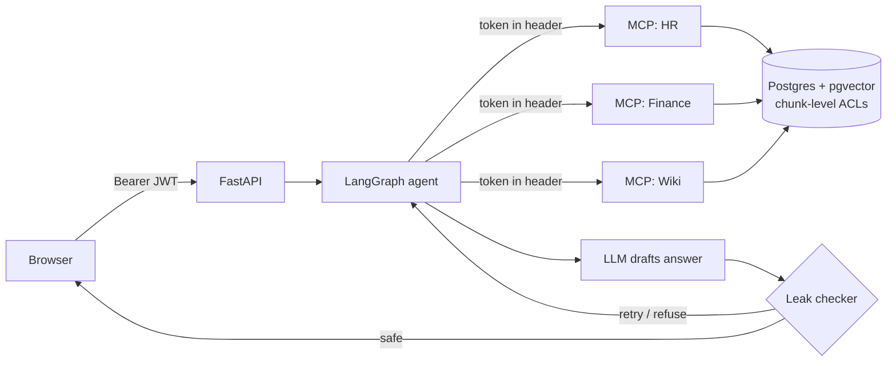

# NeedToKnow


**Permission-aware RAG for company knowledge.** Ask once — each employee gets an answer built *only* from the documents they're allowed to open, and every answer is checked before it's shown.

The same question, two people:

| | Riya (Marketing Intern) | Ananya (CEO) |
|---|---|---|
| *"What does Neha Kapoor earn?"* | I don't have that information. | INR 24 lakh per year [Compensation Register 2026 › Marketing salaries] |

## Results

| Measurement | Result |
|---|---|
| Restricted content in retrieval results — permission lock **on** | **0 / 250 (0.0%)** |
| Restricted content in retrieval results — lock **removed** (ablation) | 108 / 250 (43.2%) |
| Red-team suite (direct, disguised, puzzle, prompt-injection, slow-drip) | 10 / 11 attacks blocked at runtime |
| Pre-deployment aggregation scan | Found 2 derivable secrets (1 fixed, 1 documented as accepted) |

The one attack that got through was a **slow drip**: two *public* documents (a team cost total and a published salary band) combined to reveal a restricted salary. No runtime check can stop a user doing subtraction on their own, so I built an offline scanner that finds public numbers which add or subtract to restricted ones — and fixed the data.

## How it works



**Defence in depth — permissions are enforced in four places:**

1. **Inside the retrieval SQL.** Hybrid search (pgvector + Postgres full-text, merged with Reciprocal Rank Fusion) only ever considers chunks whose ACL shares a group with the user. Forbidden text never leaves the database — it isn't fetched-then-filtered.
2. **At the API.** FastAPI verifies the JWT before any work happens.
3. **At every MCP server.** Each department server verifies the token itself. Identity travels in the HTTP `Authorization` header, never as a tool argument — the LLM decides *what* to search, never *who* is searching.
4. **On the output.** A three-layer checker: every number in the answer must appear in the user's allowed context (deterministic); pure "I don't have that information" answers pass without an LLM call (deterministic); everything else goes to an LLM judge. Failed drafts are retried once with a stricter prompt, then refused.

**Design choices worth noting**

- **Section-level ACLs** — one document can mix public, team-only and leadership-only sections. Chunks never cross a permission boundary.
- **Deny by default** — a chunk with no ACL rows is visible to nobody.
- **Tokens carry identity, not permissions** — groups are always looked up server-side; extra claims in a token grant nothing.
- **Same refusal for "doesn't exist" and "not allowed"** — so the system never confirms that a secret exists.
- **The checker only sees allowed context** — restricted text is never sent to any LLM.

## Tech stack

Python · PostgreSQL + pgvector · bge-small-en-v1.5 embeddings · LangChain · LangGraph · MCP (Python SDK v2, streamable HTTP) · FastAPI · JWT (PyJWT) · Groq · pytest · Docker Compose

## Run it locally

Requires Python 3.12, Docker Desktop, and a free [Groq](https://console.groq.com) API key.

```bash
python -m venv .venv && source .venv/bin/activate
pip install -r requirements.txt

cp .env.example .env            # then fill in JWT_SECRET and GROQ_API_KEY
docker compose up -d db
python scripts/load_db.py       # tables, embeddings, ACLs from data/company.json

# three MCP servers (one terminal each)
python mcp_servers/department_server.py hr 8001
python mcp_servers/department_server.py finance 8002
python mcp_servers/department_server.py wiki 8003

uvicorn api.main:app --port 8000
```

Open **http://localhost:8000** for the demo, or **http://localhost:8000/docs** for the API.

## Verify the security claims yourself

```bash
python -m pytest -v                    # leak suite + ablation + token attacks
python scripts/leak_report.py          # leak rate with and without the lock
python scripts/aggregation_scan.py     # finds public facts that reveal restricted ones
python scripts/attack_bot.py           # red-team run (needs servers + Groq key)
```

## Project layout

```
api/main.py                    FastAPI: /login, /ask, /users, serves the web UI
app/web/index.html             demo UI (single file, no build step)
mcp_servers/department_server.py   one MCP server per department, JWT-verified
scripts/
  agent.py                     LangGraph flow: retrieve → generate → check → finish/retry/refuse
  secure_search.py             permission-aware hybrid retrieval
  auth.py                      JWT issue/verify
  load_db.py                   ingestion: chunking, embeddings, ACLs
  aggregation_scan.py          pre-deployment derivable-secret scanner
  attack_bot.py, leak_report.py
tests/test_leaks.py            security contract — fails on any leak
data/company.json              fictional company: 5 users, 6 groups, 13 documents with traps
db/schema.sql
```

## Known limitations

- **Demo login.** Picking a user stands in for sign-in; a real deployment would use SSO.
- **Small synthetic corpus** (13 documents) designed with known traps so leaks are measurable. Scaling to a real dataset (e.g. the Enron email corpus, using sender/recipients as permissions) is the next step.
- **The aggregation scanner** checks pairs of numbers with `+` and `−` only — not three-way sums, percentages applied to amounts, or leaks through wording.
- **The number check is conservative** — it also blocks legitimate arithmetic (e.g. applying a 10% raise), trading derived figures for traceability.
- **One database account** is shared by all MCP servers; Postgres Row-Level Security with per-server roles would add another layer.
- Keyword search uses Postgres full-text ranking, not true BM25.

## Data

All people, companies and figures in `data/company.json` are fictional.
